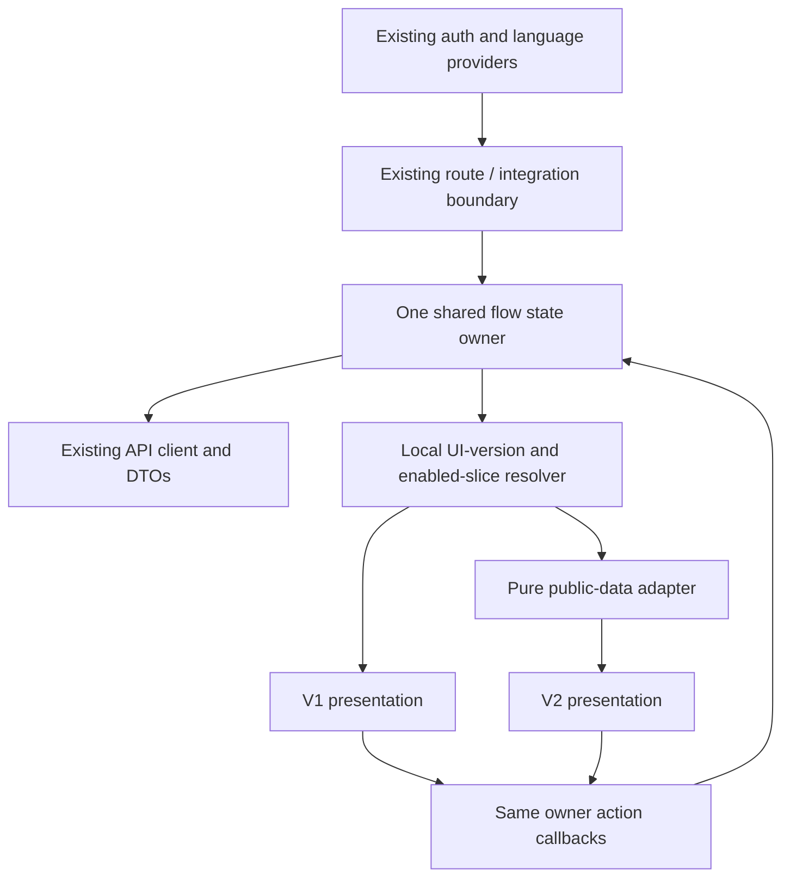

# Wombo UI V2 technical architecture

Date: 2026-10-02. Status: implementation handoff; documentation only.
Inspected branch: `fix/pre-ui-beta-blockers`.
Inspected HEAD: `6bb3a047139d91c71ac065c35a8af595221b54c5`.

Read with the [implementation plan](WOMBO_UI_V2_IMPLEMENTATION_PLAN.md) and
[dependency decisions](WOMBO_UI_V2_DEPENDENCY_DECISIONS.md). The approved
[Astra specification](WOMBO_UI_V2_SPEC.md), [screen map](WOMBO_UI_V2_SCREEN_MAP.md)
and [tokens](WOMBO_UI_V2_TOKENS.md) own visual and UX decisions. This document
defines their technical implementation, not a replacement design.

## 1. Evidence and current architecture

Repository paths in code spans are relative to the root. Follow
[root instructions](../../AGENTS.md), [mobile instructions](../../mobile/AGENTS.md),
the [MVP roadmap](../implementation/mvp-roadmap.md), and the later
[selection decision and final addendum](../requirements/joren-workout-selection-phase-2026-09-28.md)
and [planning ruleset record](../implementation/joren-planning-ruleset-v2.md).
Historical roadmap paragraphs must not reactivate older planning behavior.
The modified `backend/app/modules/coach/weekly_plan.py` is pre-existing work,
not a UI dependency to edit or commit.

### Runtime entry, navigation and state

- `mobile/package.json` uses `expo-router/entry`. `mobile/index.ts` still
  registers the older `App.tsx` manual screen switch, but that entry is not
  selected by package.json. Do not implement V2 switching in either legacy file.
- `mobile/app/_layout.tsx` owns GestureHandlerRootView, SafeAreaProvider,
  LanguageProvider, BottomSheetModalProvider, StatusBar, AuthProvider and a
  headerless Expo Router Stack, in that order. Preserve provider ordering.
- `mobile/app/index.tsx` redirects a signed-in session to `/onboarding`.
  `app/(authenticated)/_layout.tsx` checks session/configuration and renders
  another Stack plus a pathname-driven pending-RPE reminder. The authenticated
  layout itself does **not** check onboarding readiness on every direct route.
- `/onboarding` uses `useIsFocused`; `OnboardingScreen` reloads server resume
  state and opens `/planning` when `current_step === 'completed'`. The gate
  and version upgrade behavior must survive changing the home composition.
- Route wrappers pass `session.access_token` and navigation callbacks to
  screens. No bottom tabs exist. Planning's `plan`, `deck`, and `calendar` are
  local views. `/tests` and `/calibration` both expose calibration; some routes
  use `backToPreviousOrPlanning`, while Activities currently replaces
  `/planning` on Back. Origin preservation is therefore explicit migration
  work, not an already universal guarantee.
- Shared contexts are auth and language. Domain data, forms, refs, mutation
  locks and recovery state primarily live in screens. There is no installed
  Redux/Zustand/React Query layer and no existing reusable planning/activity
  controller or `src/hooks` directory to claim as available.
- AuthProvider is the single session owner. Supabase client is a singleton,
  uses processLock, in-memory session and established SecureStore refresh-token
  storage; AppState drives token auto-refresh. LanguageProvider owns persisted
  `system`/Dutch/English preference. V2 consumes these unchanged.
- `src/api/client.ts` owns authenticated FastAPI transport, typed endpoint
  functions, safe error messages, onboarding read retries, idempotency headers
  and `submitActivityRpeWithRefresh`. ApiRequestError is internal, not an
  exported UI error taxonomy. Do not parse error-message text into new
  permission/retry rules or copy the transport's error mapping into V2.
- If a later migrated flow needs typed error-code/outcome metadata, expose a
  small shared accessor around that existing error class in a separate mobile
  transport seam commit. Return its existing code/status/retryable values,
  retaining unknown fallback and safe messages; change no endpoints, payloads,
  codes or retry behavior. Reuse it in both controller presentations and test
  transport parity. This is not needed for the read-only first slice.
- `src/api/types.ts` owns public DTOs. Decimal quantities are often strings,
  date-only fields differ from actual instants, and template IDs differ from
  occurrence IDs. No new API model is needed for presentation.

### A/B/C/D reuse classification

A = safe shared logic/data; B = V1 presentation; C = coupled code requiring a
small, tested separation before reuse; D = protected behavior/layers for this
migration. A module can contain both B and C responsibilities: classify the
responsibility, not just its filename.

| Area and concrete source | Classification and finding | V2 boundary / timing |
| --- | --- | --- |
| `src/api/client.ts`, `src/api/types.ts` | A; transport, public objects and revisions. D for endpoint/payload/error-code semantics | Import unchanged; never copy clients or fork DTOs |
| `src/auth/AuthProvider.tsx`, `src/lib/supabase.ts`, `src/i18n/LanguageProvider.tsx` | A; existing context/storage. D for credential/session semantics | One provider instance for both UIs; add localized V2 keys only |
| `src/lib/rpe.ts`, `runPace.ts`, `dateInput.ts`, `onboardingForms.ts`, `workoutPresentation.ts` | A; canonical copy, parsing, formatting, goal representation and RPE-sentence filtering | Reuse exact functions. `observedRunPace` is existing actual-activity formatting, never a planned swim-duration estimator. Client coverage notices are not new physiological rules |
| `src/lib/navigation.ts` | A deferred sheet dismissal; B `/planning` fallback coupling | Reuse dismiss sequencer. Extend origin/fallback handling in navigation slice with V1-compatible default |
| `PlanningScreen.tsx` (2,392 lines) | C; storage restore, plan/draft state, revisions, generation, approval, moves and calendar fetch race guard coexist with JSX/styles | Extract one planning controller incrementally before mutating V2 planning. Separate calendar read state from mutation busy state |
| Planning `WorkoutCard`, `WorkoutSignals`, `ActionButton`, profile sheet | B; styles/copy/signals local to screen | V2 summary/actions use approved components; leave V1 rendering intact |
| Planning `deckItemFor` | C; fabricates `workout_kind` via a protocol-id substring and sets evidence contribution false | Do not reuse as V2 source classification. Planned snapshots lack those deck signals: omit unless explicitly supplied |
| Planning `SwipeDraftPanel` | C; PanResponder/Animated gesture locks and candidate effects around shared action callbacks; nested accepted list ScrollView | Keep transition action in shared owner; replace only gesture/presentation in its later slice. Occurrence identity must drive V2 keys and candidate changes |
| Planning `PendingWorkoutEditor` | C; fetches alternatives, carries proposal/revision, mutates pending plan and renders parallax carousel; `can_remove` returned but this JSX does not expose a remove action | Share fetch/edit transaction; one focused V2 alternatives view. Surface removal only when returned `can_remove`; test that specific capability, never active deletion |
| `TrainingCalendar.tsx` | B/C; local mode/anchor/selected date, date helpers and range effect combined with grid/week JSX | Extract a controlled calendar state helper when replacing view; retain exclusive end and latest-request guard in read controller |
| `WeekSchedule.tsx` | C; date validation and measured drop resolver mixed with handle/Animated/PanResponder and accessible date actions | Preserve dedicated handle, seven dates, full-layout validation and exact active revision. Keep V1 gesture implementation untouched; V2 read-only agenda first |
| `WorkoutDetail.tsx` | B plus pure target selection; full-page RN Modal consuming selected `PlannedWorkout`, no network/mutations | First slice uses same snapshot/onClose. Target precedence becomes a pure V2 mapper with parity tests; no controller extraction |
| `ActivityScreen.tsx` (777 lines) | C; lists/calendar/timezone reads, selection, UUID key, created ID, create/RPE refs, HR drafts, matching, correction eligibility and FlashList rendering | Extract one activity controller before V2 entry/feedback. Keep key/ID/locks above presentation switching and entry/history transitions |
| `RpeChoiceList.tsx` | B presentation with A canonical choice source | V2 RpeChoices consumes `src/lib/rpe.ts` unchanged; tap-to-save remains |
| `OnboardingScreen.tsx` (1,914 lines), exported Profile/Goal/History/Review steps | C; step form state, conversions, readiness, reload and separate writes combined with layout | Extract only needed form/controller responsibility per late slice. Reuse ProfileStep behavior via callbacks before any new editor capability |
| `ZoneSetupStep.tsx` | C; option/protocol fetching, selected route, known thresholds/boundaries and payload construction with fields | Split in final setup slice, preserving exclusions and existing validators; no new physiological route |
| `CalibrationScreen.tsx` (1,502 lines), `ZoneProfileScreen.tsx` (971 lines) | C; activity/observations/evaluation/threshold/zone operations, provenance, visibility and form state in JSX | Last complex migration; shared controller plus visibility-safe mapper. Do not linearize separate confirmations |
| `CheckInScreen.tsx` | C; context/extraction adoption, revisions, restrictions/external activity, save/confirm/propose/approve | Dedicated late slice; retain every input and separate operation |
| `ProfileScreen`, `IntegrationsScreen`, `PioneerAccessScreen`, `AuthScreen` | C for form/network/actions; B for surface/header/group composition | Reuse flows, thin controller separation only as required; no new account/provider behavior |
| `FormField`, `DurationPicker`, `ScreenState`, `StatusPill` | B with reusable controlled-input semantics | Preserve parsers/null precision; introduce smaller V2 visuals as each flow needs them; no global V1 restyling |
| `src/theme/tokens.ts`, per-file StyleSheet, `tailwind.config.js` | B; current 6/10 spacing, spring/heavy shadows differ from Astra | Separate V2 token source; retain V1 theme values and global Tailwind definitions |
| `FadeInView`, `MotionPressable` | B; springs/default press scale differ from V2. MotionPressable records NativeWind's function-style interop issue | V2 timing helpers, concrete style arrays; do not change V1 helpers globally |
| `HomeScreen.tsx` | B static preview, not routed live functionality | Do not promote mock times, Coach tab or example statistics into Week |
| `backend/**`, `supabase/**`, API contracts, physiological models/rulesets, release config | D | No edits, recalculation, migration, service setup, deployment or hosted mutation |

The inspection establishes source behavior, not physical-device fidelity or
measured performance. The existing activity/HR/RPE, delayed retry, Month/Week,
drag/drop and workout-detail Android gates remain open.

## 2. Smallest parallel presentation boundary

Adopt the proposed directory under `src`, which is already the alias root and
included by strict TypeScript, Jest and Tailwind's `src/**/*` scan. Keep routes
under `mobile/app`; never create a second application/bootstrap.

```text
mobile/src/
  api/                         existing public contracts and transport
  auth/                        existing session owner
  i18n/                        existing preference and localized copy
  lib/                         existing parsers/presentation helpers
  screens/                     V1; retain until device acceptance
  components/                  V1; retain unchanged
  theme/                       V1 tokens unchanged
  ui/                          small version-neutral integration seam
    uiVersion.ts               pure resolver + enabled-slice registry
    UiVersionProvider.tsx      dev preference; no persisted/server state
    UiVersionControl.tsx       dev-only labeled V1/V2 control
    WorkoutDetailBoundary.tsx  same props; mounts one detail implementation
  features/                    create only for a flow being migrated
    planning/                  controller + resume IDs; no V2 styles
    calendar/                  read range controller + date/anchor state
    activities/                one create/feedback recovery owner
    onboarding/                later controller/forms
    calibration/               later controller/forms
    check-in/                  later controller/forms
  ui-v2/
    tokens/                    semantic values, typography, layout, motion
    primitives/                RN-based controlled visual building blocks
    components/                domain-informed, non-mutating compositions
    screens/                   Astra compositions; receive state/actions
    motion/                    timings, cancellation, reduced motion
    utils/                     pure adapters + their UI view-model types
```

Do not create empty folders or export barrels for unimplemented screens.
V2 `utils` may import DTO types and safe `lib` helpers; no API, auth, storage or
effects. Screens and components receive values/callbacks from boundaries;
shared controllers alone import mutation clients. Route wrappers remain thin.
No V1 imports from V2 adapters are required. V1 and V2 consume the same
controller only after a narrowly scoped extraction has passed V1 regression.



Controller extraction is a separate mechanical commit per flow: preserve
operation order, request inputs, keys, guards, returned state and errors; move
JSX/styles only into a V1 view if necessary. Do not use extraction to repair
baseline bugs, alter defaults, add caches or optimize unrelated effects.
There is one active owner, not one hook instance in each UI. Before the tabs
slice, route/container lifetime is sufficient. Before navigation can remount
flows, move their owners into a lazy flow host above that navigator. Reset
on identity change/sign-out, not UI version or token refresh; never key the
host by the rotating access token. Use the existing verified session identity
only for isolation, never a client-authoritative identity in a request.

## 3. Development switch and rollback

Use an in-memory development preference with a build-time initial value.
`src/ui/uiVersion.ts` owns resolution, not any screen's private flag.
The only initial environment input is `EXPO_PUBLIC_UI_VERSION`; it contains
`v1` or `v2`, is public, and is read with static dot notation. Expo inlines
these variables into the bundle; a changed value requires a reload, so the
environment flag alone cannot preserve live retry state.
[Expo environment-variable documentation](https://docs.expo.dev/guides/environment-variables/).

Illustrative policy, not code installed by this task:

```ts
type UiVersion = 'v1' | 'v2';
function initialUiVersion(isDev: boolean, flag: string | undefined): UiVersion {
  return isDev && flag === 'v2' ? 'v2' : 'v1';
}
// production/release request => v1, even if the environment says v2
// effectiveVersion(slice) => v2 only if requested v2 AND implementedSlices[slice]
```

Place UiVersionProvider in `mobile/app/_layout.tsx` **inside AuthProvider,
around its Stack**. All existing providers keep their ordering/lifetime.
Read preference only in small boundaries and, later, the training layout.
UiVersionControl is a dev-only integration control, initially visible near the
Planning header and within the read-only detail boundary for comparison.
V1/V2 label and disabled reason must be accessible. No production settings row,
SecureStore preference, query-param override, remote flag, cohort or server
dependency. Invalid/unset values select V1. `__DEV__ === false` forces V1 and
hides the control, including current EAS preview/wombo release bundles. Testing
V2 here uses the existing local development client; enabling release-mode V2
is separately reviewed later, not silently inferred from a profile name.

Enforce the non-development V1 rule in both initial preference and effective
slice resolution; a programmatic preference update must not enable release V2.
Register implemented slices explicitly, beginning only with `workoutDetail`.
Unmigrated screens stay V1 even in V2 mode. Do not mount hidden copies of both
UIs; that doubles effects and risks writes. No separate per-screen preference
system is needed: one preference plus a static implementation registry.

### Live switch safety

1. First detail slice: selected workout remains in PlanningScreen; close and
   origin remain outside the switched body. Switch the read-only detail using
   the same snapshot; capture/restore its scroll offset and focused segment.
   No network, storage or mutation is caused by toggling.
2. Later controllers remain mounted above the switched presentation. Their
   proposal ID/revision, draft occurrence IDs, HR input, form values, create
   UUID/key, created activity ID and locks survive. Pure V2 view errors may
   fall back to V1 through a boundary error state without remounting the owner.
   A view error boundary cannot catch native/JS-bundle initialization failure;
   that still needs starting the known V1 bundle.
3. A gesture must cancel to the committed origin before switching. Close a
   sheet through `createDeferredDismissAction`; do not navigate while dismissing.
   Never reset the owner to make toggling look successful.
4. Disable interactive switching while a submission, ambiguous outcome,
   pending move confirmation or unreconciled write exists. Show the reason;
   resolve through the existing operation/reconciliation, then toggle. An
   in-flight completion callback is never an animation completion callback.
5. Preserve editable transient values in the shared owner before enabling
   that slice. If a V1 local form cannot be retained yet, the slice is not
   eligible for live switching during that task. Do not discard a task on
   forced navigation or promise cross-restart persistence the baseline lacks.
6. A later shell change occurs from a settled root destination after task
   close/reconciliation, with saved date/mode/scroll context above the keyed
   navigator. Navigators may remount; auth and flow owners may not. Map a V2
   Calendar origin back to V1 Planning's calendar view, not a new default week.

Rollback is immediate presentation selection at a safe boundary, without Git
or data rollback. A network operation's uncertainty necessarily takes priority
over switching a mutating task. That is an integrity constraint, not a reason
to clear state. Developers can compare the same public fixtures immediately;
never submit twice to compare versions.

## 4. Token implementation

Use typed `as const` TypeScript tokens consumed by StyleSheet and animated
styles. Keep `src/theme/tokens.ts` and Tailwind's V1 names unchanged. No global
theme provider is necessary for Astra's single light theme. Separate files
`colors.ts`, `typography.ts`, `layout.ts`, `motion.ts`, `states.ts`, `index.ts`
are enough. Component state tokens reference these values, not new hex codes.

### Exact semantic color mapping

| V2 path | Astra token/value |
| --- | --- |
| `surface.canvas` | background `#F4F2EC` |
| `surface.card` | surface `#FFFEFA` |
| `surface.elevated` | `#FFFFFF` |
| `surface.subtle` | `#E9EEE8` |
| `text.primary` | text `#102B28` |
| `text.secondary`, `text.placeholder` | text.muted `#5D706B` |
| `text.inverse` | `#FFFEFA` |
| `action.primary.default`, `.pressed`, `.soft` | `#123F39`, `#082E2A`, `#DCEBE3` |
| `action.secondary.background`, `.text` | `#DCEBE3`, `#123F39` |
| `border.decorative`, `.control` | `#D9E0DA`, `#70837D` |
| `focus.default`, `.inverse` | `#123F39`, ivory `#FFFEFA` separation on forest |
| `status.success.foreground`, `.background` | `#2D6A52`, `#E4F0E8` |
| `status.warning.foreground`, `.background` | `#79520E`, `#F8EED6` |
| `status.error.foreground`, `.background` | destructive `#A23B2A`, `#FBE5DF` |
| `action.destructive` | reference status.error foreground; no separate red |
| `sport.run.foreground`, `.background` | `#8F442F`, `#F5E8DF` |
| `sport.bike.foreground`, `.background` | `#405C45`, `#E6ECE2` |
| `sport.swim.foreground`, `.background` | `#285E70`, `#E2EDF0` |
| `overlay.scrim` | `rgba(16,43,40,0.28)` |

Intensity uses supplied low/high labels independently of sport. ZoneBadge is a
neutral labeled target, never a client-generated zone heatmap. Waiting uses
neutral text/surface; success only follows acknowledgment. Names above are
technical aliases for Astra values, not palette revisions.

### Typography, dimensions and state references

| Group | Implementation values |
| --- | --- |
| Typography variants `(size/lineHeight, weight)` | display `(32/38,700)`; screenTitle `(28/34,700)`; sectionTitle `(20/26,600)`; cardTitle `(18/24,600)`; body `(16/24,400)`; supporting `(14/20,400)`; caption `(12/16,500)`; label `(14/20,600)`; button `(16/22,600)`; numeric `(28/34,600)`; numericCompact `(20/26,600)` |
| Font | native system sans, normal letter spacing; tabular digits for measures if supported; RN scalable font sizes/line heights, no font-scale clamp |
| Spacing | `space[4|8|12|16|24|32|48]`; no unbounded arbitrary spacing props |
| Named layout exceptions | phone gutter/card padding 16; wide gutter 24; reading width 600; focus padding 20 or 24; agenda date column 48/gap 12; action-area top/bottom 12 plus bottom inset |
| Radii | inset 8; control 12; card 20; sheet 28; pill 999 |
| Sizes | touch 48; primary button/input 52; tab 56 above inset; inline icon 20/action icon 24; focus outline 2 |
| Elevation | flat/card 0; lifted drag 2 with optional shadow opacity .08/offset 0,2/radius 8; sheet 6 with optional .12/0,4/16 |
| Motion | press 90; arrive/week 160; selection/expand/return 180; pickup 100; settle/loadingContent 140; saved 120; sheet enter 220/exit 160; candidate travel <=8; drag scale <=1.02 |
| Button states | default/pressed from action; disabled readable text on subtle surface, no blanket opacity; busy retains label, suppresses repeated handler calls |
| Input states | default control border; focus 2 dp without size change; error icon/text + error border; value never cleared on failure |
| Selection states | fill plus check and selected/checked semantics; disabled retains reason; no separate palette |

Use semantic token keys in component styles. Limit raw literals to this token
source and deliberate geometry such as `flex: 1`; do not generate hundreds of
component-specific tokens. If utility classes are later used, expose prefixed
V2 aliases from the same token source and test parity; do not independently
maintain a second palette in Tailwind.

## 5. Minimum primitives

Start with Screen, Text, Card, Button, IconButton and Divider; add Input,
SegmentedControl, Chip, Sheet and Skeleton only in slices that use them.
Ordinary View + token `gap` is sufficient initially; introduce Stack/Inline
only when repeated composition warrants a small wrapper. No generic form
engine, polymorphic component framework or universal data grid.

| Primitive | Purpose and minimum props | Accessibility and state behavior |
| --- | --- | --- |
| Screen | safe-area, max reading width, one content owner; `title`, `children`, `onBack?`, `scroll: none/scroll/list`, `footer?`, `keyboardAware?` | Heading focus; safe footer inset. List variant is a non-scroll frame, not another ScrollView. Error/loading content supplied explicitly. At 200% text footer can enter flow |
| Stack / Inline (defer) | layout only; `gap: SpaceKey`, `align?`, `wrap?`, children | No focus/role/loading. Inline wraps rather than clips; no order changes |
| Text (export as WomboText if useful) | typed typography and semantic color; `variant`, `tone`, text/RN accessibility props | Font scaling on; heading role explicit. Full critical copy. No implicit announcements or loading |
| Card | visual grouping; `tone: standard/focus/lifted`, children | Plain View by default, no fake button role. Interaction supplied by a named control; no nested-card habit. No data fetching |
| Button | primary/secondary/tertiary/destructive; `label`, `onPress`, `busy?`, `disabled?`, `disabledReason?`, `icon?` | role button; busy/disabled state; 52 primary/48 others; label stays while spinner appears; no duplicate calls. Error rendered by owning task, not swallowed |
| IconButton | compact named action; `icon`, required localized `label`, `onPress`, `busy?`, `disabled?`, `selected?` | 48 target/24 glyph; verb + object label; no emoji/initial substitutes. Reason/visible status beside control |
| Chip | category checkbox or radio; `label`, `selected`, `onChange`, `mode`, `disabled?` | Correct multiple/exclusive role/state, check plus text/fill, 48 target and wrapping. Does not choose business eligibility |
| Divider | decorative separation; `inset?` | Hidden from accessibility, no status/action semantics |
| Input | persistent label/value; `label`, `value`, `onChangeText`, `unit?`, `hint?`, `error?`, `required?`, `disabled?`, native keyboard/autofill props | Label spoken with unit; invalid/error associated and announced once; min 52 field; focus outline reserved. Blank distinct from zero. No new validation limits |
| SegmentedControl | bounded exclusive modes; typed `options`, `value`, `onChange`, `disabled?` | tab semantics for views, radio for form choice; explicit selected; 48 targets, wrap/stack at large text. Busy lock supplied by owner |
| Sheet | bounded contextual choice; `open`, `title`, `onDismiss`, children, trigger ref | Existing Gorhom modal, visible close, safe insets, Android back, focus containment/restoration. One scrollable owner; expand to full height when needed. Dismiss never saves/approves |
| Skeleton | initial-load placeholders; `kind`, bounded count | Static neutral blocks excluded from tree; one loading announcement outside. No shimmer, percentages or skeleton after a known error |

V2 Button may use RN Pressable with explicit press state and concrete style
arrays. The installed NativeWind interop issue is relevant even with StyleSheet.
Do not casually replace that handling with function-valued `style` props.
Busy state is UI feedback; the controller's synchronous lock is still required.

## 6. Signature components and adapters

All actions are callbacks into the existing/shared owner. Components never
own endpoints, approval, target calculations, timing eligibility or retries.

| Component | Input boundary and responsibility |
| --- | --- |
| WeekContext | localized range and explicit plan/proposal context VM; previous/next/current callbacks. Separate selected display week from next-week creation form |
| NextSession | `NextSessionViewModel` from active plan snapshot plus explicit today/date context; one focus + same-date siblings, no execution order or guessed time |
| WorkoutSummary / workout card | `WorkoutSummaryViewModel` from planned snapshot or deck occurrence with discriminated context; measures, exact source title, supplied bucket/status; filtered card description |
| SessionSequence | readonly `WorkoutSegment[]` plus locale/target formatter or mapped segment VM; ordered rail, visible instructions, supplied targets; no repeat parsing |
| WeekAgenda | `WeekAgendaViewModel` of seven dates/workout rows/rest rows + explicit `approvedRange/activePlan/proposal` provenance. Read-only first; move/edit callbacks are separately enabled by owner |
| AvailabilityDays | readonly date entries/checked set, `onToggle`, reuse callback/busy/error. Can consume controlled date/selection values directly, not a plan algorithm |
| AttentionRow | small VM of known fact, affected identity, action label and callback; no guessed due dates/clinical readiness priority engine |
| SaveStatus | explicit UI operation state from controller: editing/saving/confirmed/refreshNeeded/outcomeUnknown/retry/complete. Optional safe public message/retry callback; never inferred from timeout or animation |
| SportIndicator | supplied `Discipline` + localized label; text and small accent icon |
| ZoneBadge | explicit segment `zone_target` number, label; no zone boundary calculation |
| RpeIndicator / RpeChoices | supplied expected range or actual value, distinct labels; canonical sport text from `lib/rpe.ts`; choices are save-on-tap callbacks, disabled/busy/selected state from owner |
| DayHeader | date/count/rest VM; full date label, growing content; count of workouts not availability |
| ActivityFeedback | activity summary VM + controlled HR draft + canonical choices + SaveStatus; no create/save logic inside it |
| CalibrationState / ZoneTable | visibility-safe VM from actual setup/evaluation/decision/profile data. Hidden variant contains **no numeric bounds**, even in labels; separate threshold/zone decisions and history |

### Pure mapper rules

Place local types and mappers in `ui-v2/utils`, named by purpose:
`workoutDetailViewModel.ts`, `workoutSummaryViewModel.ts`,
`weekAgendaViewModel.ts`, `weekHomeViewModel.ts`, `activityViewModel.ts`,
`zoneProfileViewModel.ts`. Create as used, not all at once. Inputs are public
DTOs plus explicit locale/timezone/date/context; outputs are readonly,
allowlisted display fields and opaque identities. No object spreading of a
whole server response into accessibility, logs, UI props or analytics.

- No I/O, React effects, Date.now, randomness, mutation, LLM or physiology.
  Supply `today` and language/date context for deterministic tests. Sort a
  copied segment array by supplied sequence; do not mutate snapshots or invent
  phase names. Same-date sessions have stable display order without claiming
  execution order.
- Display known minutes/meters independently; null is absent, not zero. Use
  existing public plan time totals when trustworthy, or a clearly qualified
  sum of supplied durations. Never infer swim duration or recompute intensity
  shares/coaching scores. Whole-workout bucket is not recalculated from zones.
- Detail target priority remains `zone_target`, `rpe_target`,
  `protocol_target`, `expected_rpe`. Preserve range equality and exact text.
  RPE reference is optional; execution instructions are not.
- A planned row ID identifies a planned occurrence; `occurrence_id` identifies
  a draft selection; template ID/version identifies source. Never synthesize
  an API PlannedWorkout from a candidate just to satisfy a component type.
  V2 detail can later consume a discriminated planned/candidate presentation
  input with no invented date/status/ID; this is not a public DTO fork.
- WeekHome uses an identified loaded active revision for progress, excludes
  cancelled occurrences and counts completed planned occurrences only. Pending
  revision and approved calendar range must not be conflated. The existing
  restore may load a pending latest plan; fetch the known active revision
  through existing `getWeeklyPlan(..., revision)` where available. If a selected
  week cannot be identified from loaded data, omit claims rather than synthesize
  a discovery endpoint or infer a plan from calendar emptiness.
- WeekAgenda consumes actual rest records and workouts independently, even
  if both exist on a date. Generate seven date headings, not seven invented
  rest prescriptions. Known active same-week context is required for moves;
  range DTOs alone cannot grant them or imply approval metadata.
- Activity presentation does not infer completion from a selected RPE row.
  It consumes returned processing/match/result state; suggestions require
  explicit confirmation. Ruleset/model versions stay on original objects and
  provenance disclosures; no historical remapping from contemporary zones.
- Zone mapper drops numeric values before building any visual/a11y text when
  `values_hidden` or existing visibility policy hides them; null/open bounds
  stay open. Use existing run-pace formatter and explicit swim `sec/100 m`.
  Do not invent swim rounding/clock precision.
- Error text uses existing safe client messages and existing warning
  presentation mapping; do not expose rule/revision identifiers in ordinary
  copy. A future localization of error taxonomy must remain shared and requires
  its own transport regression review, not a second V2 implementation.

## 7. Navigation migration

Keep Expo Router and the current root/authenticated Stacks first. The first
detail is a full-height RN Modal reached from the existing WeekSchedule and
TrainingCalendar callbacks, not a new route. It is a full-height task surface
as Astra requires and technically already supported; the root navigator
continues to own origin. Do not pass snapshots or tokens through URL params.

| Stage | Concrete path/change | Preservation requirement |
| --- | --- | --- |
| Detail | Replace only Planning's detail import/use with boundary | Same selected object, null visibility, onClose, Android back; no new fetching |
| Week + read-only calendar | Existing `/planning` chooses V1 or thin V2 composition using shared state; internal Week/Calendar entry until shell ready | No second full agenda under Week; proposal remains separate task; existing V1 task/editor fallback |
| Three-destination shell | Later move public `/planning` and `/activities` wrappers into a pathless `(training)` group, add `/calendar`; `app/(authenticated)/(training)/_layout.tsx` delegates to version-neutral TrainingLayout | V2 JavaScript Tabs: `/planning` label Week, `/calendar` label Calendar, `/activities` label Activities; V1 Stack/default Planning internal views remain. Pathless group keeps public URLs; use typed routes after regeneration |
| Focused tasks | Authenticated parent Stack outside tabs holds existing `/profile`, `/onboarding`, `/zone-profile`, `/tests`, `/calibration`, `/check-in`, `/integrations`, `/pioneer-access`; planning task body may remain controlled inside Planning until split | Tabs hidden for focused tasks. No new domain operations just to add routes. Profile is secondary action on each root |
| Optional later detail route | Only if later navigation needs direct entry, introduce `/workout-detail` with public source ID/context lookup through existing owner | Not necessary in first slice; unknown snapshot shows load/unavailable state, not current template substitution. Candidate details may remain owned modal |
| Activities | V2 history and entry/feedback are controlled subviews under shared activities owner, rather than duplicating independent `/activity/new` screens | Same saved activity/key across transition; detail-to-log entry only after explicit handoff exists |
| Profile/setup | Parent stack routes reused; goal/history/operational edit links use supported onboarding/setup flow with explicit intent | Do not invent standalone Goal API/route; preserve version resume and separate writes |

Use the Router's existing JavaScript Tabs rather than an experimental navigator
or custom routing framework. [Expo Router tabs](https://docs.expo.dev/router/advanced/tabs/).
Moving wrappers is a single later route-only commit with link/back tests; do
not keep duplicate public route files in old and new groups.

Before that move, add a version-neutral lazy TrainingFlowHost above the
conditional Stack/Tabs layout, inside the authenticated shell. Planning and
calendar share one planning owner, activities one separate owner loaded only
on use. Visibility/focus controls reads; hidden tabs must not continuously
reload or mutate. Both navigators consume the same host; switching from a
settled root remaps destination/context before navigator replacement. Existing
non-training tasks remain on the stable parent Stack.

The V2 shell needs a server-resume readiness check for direct entry because the
current authenticated layout only proves session validity. Reuse getOnboarding
and current completed-step/version semantics in the shared training gate; do
not invent readiness criteria. Preserve normal V1 entry behavior and document
direct-link regression separately. Loading/error cannot become ready.
Onboarding completion still opens `/planning`, now labeled Week for V2.

Navigation UI context is local (source route, selected week/date, calendar
mode, scroll offset, focused occurrence). Use actual history when present;
direct task entry falls back to `/planning` (Week in V2). Preserve deferred
sheet dismissal. Replace blanket Activities `replace('/planning')` behavior
only in its reviewed origin-navigation slice; V1 compatibility tests remain.
Pending-RPE data has one shared owner when the banner becomes tab count/Week
attention; do not hide the current reminder until all replacement entries work.
On failure to refresh that count, do not imply confirmed zero pending feedback.

## 8. Motion and accessibility

Use existing Reanimated 4.5.1/Worklets 0.10.1; Gesture Handler 2.32.0 only where
gestures justify it. V2 wrappers use `withTiming`, ease-out entry/ease-in exit,
cancellable shared values, and system reduced motion. No global change to V1
FadeInView, springs or Router durations in the first slice.

| Pattern | V2 implementation / reduced motion |
| --- | --- |
| Press/selection | 90 ms fill/opacity, check + selected state; immediate fill with reduced motion; no button shrink |
| Card arrival / loading-content | 160 ms opacity + <=8 dp arrival; loading-content 140 ms stable dimensions; immediate or <=80 ms opacity reduced |
| Choose/pass | 180 ms lateral feedback without rotation/stamps; request lock and acknowledgment belong to controller; reduced immediate state + saving copy |
| Expansion | 180 ms measured height/opacity for optional explanation only; stable layout/no hidden critical text; immediate layout reduced |
| Drag | Later Gesture Handler/Reanimated pickup 100 ms <=1.02 scale, one lift; target border/text. Preserve measured growing rows and scroll coordinates; settle 140 or rejected return 180 ms; reduced outline/immediate restoration |
| Week/content navigation | 160 ms crossfade after selected context changes, never animate two mutating trees. Native stack transitions only in later nav slice; reduced animation none |
| SaveStatus | 120 ms confirmed-check fade; label persists. Saving/unknown/error are explicit owner states; announce semantic changes once, never on each opacity update |
| Sheet | Existing Gorhom provider/modal with 220 ms entrance/160 exit where supported; immediate under reduced motion; no drag-as-save |

Gesture activation thresholds are not motion duration tokens. Keep current
activation and hit-test behavior until its separately tested V2 gesture slice;
do not tune physiology or safety based on animation. Keep gesture pixels on
UI thread, bridge one settled action to JS, never a fetch/setState per frame.
Haptics are optional one-shot signals with caught failure; text/shape must work
without them. For live reduced-motion changes, subscribe through existing RN
AccessibilityInfo capability as needed; do not assume a startup-only hook
will react to settings changed while the app is open.

Technical accessibility acceptance:

- Real, nonoverlapping 48 x 48 dp targets; primary/input 52, tabs >=56 plus
  safe inset. Wrapping availability and Month list fallback follow Astra,
  never hitSlop overlap or smaller cells.
- Use roles button/header/tab/checkbox/radio/adjustable according to actual
  action, plus selected/checked/busy/disabled/expanded state. Required/errors
  use persistent labels and supported RN accessibility associations; where
  invalid is not a supported state prop, provide an associated spoken error,
  not an invented TypeScript cast.
- Icon-only controls require localized verb/object labels. Decorative glyphs,
  rails and skeletons are excluded from the tree. Group summary labels must
  not hide separately actionable detail/move controls or duplicate readings.
- Full date, sport, source title, measure/unit, state and available action;
  no private values, hidden zones or raw internal metadata in accessibility.
- Font scaling remains enabled and unclamped. Rows/cards grow; 200% text
  switches chips/forms/action bars to wrapped/stacked/in-flow composition.
  Instructions/warnings are never ellipsized. Truncated list names have a
  full spoken name and reachable detail.
- Heading focus after transition, first invalid input on submit, relevant
  save error announcement once; sheet dismiss restores trigger, rejected move
  restores occurrence focus. Do not steal typing focus on rerenders.
- Confirm all used text pairs >=4.5:1 and control/focus boundaries >=3:1,
  including additional tinted/disabled combinations. Approved token ratios
  are not proof of rendered accessibility. Do not lower opacity globally.
- Test 320/360/412 dp, Dutch/English, default/200% text, keyboard and gesture
  safe area, TalkBack, reduced motion and button equivalents to gestures.

## 9. Android performance guardrails

These are implementation budgets, not measured claims about current devices.
Target the device's refresh rate; on a 60 Hz mid-range Android, the UI-thread
frame window is about 16.7 ms. Record device/build/dataset and compare the same
scenario in V1/V2. Reject repeatable added jank or freezes; do not declare a
numerical improvement without a trace. No arbitrary network deadline or
session-count cap is introduced as a UI performance fix.

| Guardrail | Implementation constraint / high-risk surface |
| --- | --- |
| Scroll ownership | One vertical owner; Screen list mode must not wrap FlashList/SectionList. Activity history stays FlashList; ten RPE rows can be ordinary content under its task owner |
| Agenda | Seven headings with natural row heights. Group supplied occurrences once by date; no full WeekSchedule plus TrainingCalendar side by side. Use a list owner for large content, keep drag geometry valid for mounted rows and accessible date moves for offscreen targets |
| Month | At most the bounded 28-42-day grid plus selected-date detail; no per-cell full title list. 48 dp viewport/list fallback and one authoritative date anchor |
| Stable identity | planned `id`, draft `occurrence_id`, activity `id`, date-only heading key; template ID is not selection key. Recycled rows reset ephemeral state when identity changes |
| Memoization | Grouping/formatters only when profiling/repeated work justifies it; memoize expensive rows with stable callbacks where measured. Do not memoize every Text or use deep-comparison caches |
| Animation | UI-thread transform/opacity, bounded layout transitions only; no per-frame React state, perpetual shimmer/parallax, replay on every render, animation on every list item at once |
| Assets/surfaces | System font, small outline icons, no photographs; ordinary cards no shadow. One lifted object/sheet; no blur-dependent tab bar or nested elevation |
| Reads/render isolation | Latest-request guard for range; calendarLoading independent of planning busy. Hidden tabs/alternatives/history do not all fetch/mount at once. No new caching/pagination contract |
| Large forms | Mount one chosen setup/protocol/history detail as appropriate; preserve values in controller while optional presentation unmounts. Required instructions remain available |

Most at risk: planning alternatives and repeat-heavy agendas, dragging with
large text/multiple workouts per date, rapid Month/Week requests, activity
history plus entry/feedback, and long calibration/zone/onboarding forms.
Workout Detail is low network risk but long instructions and safe-area/focus
still need real Android verification.
