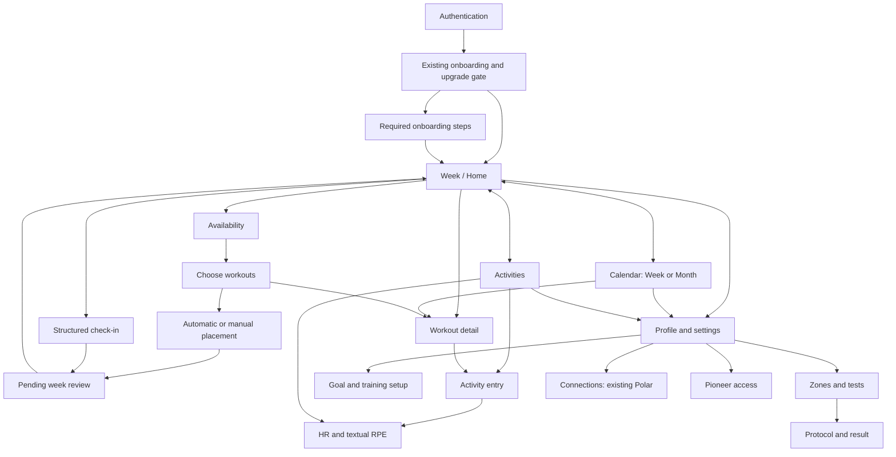

# Wombo V2 screen map and handoff

Design-only companion to the [specification](WOMBO_UI_V2_SPEC.md) and [tokens](WOMBO_UI_V2_TOKENS.md). Each screen below defines the proposed future composition; no route or behavior has been changed. All state transitions remain baseline-authoritative. “Secondary screen” describes hierarchy, not a request to create a new endpoint.

## 1. Journey and navigation map

Arrows describe user destinations, not unconditional domain transitions. Existing prerequisite checks still apply. “Pending review” never auto-activates a plan. Returning from details, feedback or settings restores the origin rather than always pushing a fresh Week screen.

### Baseline capability → V2 destination

| Current entry or component | Proposed home | Preserved capability |
| --- | --- | --- |
| `/`, `AuthScreen` | Authentication | Sign in, sign up, confirmation-email notice, configuration/session states |
| `/onboarding` | Onboarding/resume gate | Every step and upgrade, direct completion to Week |
| Planning `plan` view without plan | Week → Prepare week | Date-only availability, explicit reuse, injuries and alternative-sport opt-in |
| Planning `deck`, `SwipeDraftPanel` | Week → Choose workouts | Accept/pass, undo, reset passed, resume, occurrence identities |
| Draft placement | Choose → Plan dates | Automatic spread, manual dates, multiple per date, back/undo and submit |
| `PendingWorkoutEditor` | Pending review → Session alternatives | Replacement, server-permitted removal, fresh warnings/revision |
| Planning approval/rejection | Pending week review | Explicit approval/rejection, inactive/superseded state |
| `WeekSchedule` and `TrainingCalendar` | Calendar Week, shared agenda | Full seven days, multiple sessions, rest, same-week moves and detail |
| Calendar Month | Calendar Month | Range navigation, Today, selected date's full workout list |
| `WorkoutDetail` | Full-height workout detail | Snapshot segments and supplied targets/instructions |
| `/activities` | Activities → Entry / Feedback | Planned, extra and external logging; pending HR/RPE; matching and current-week correction |
| `/check-in` | Week → Check-in | Structured context, restrictions, fatigue, external sport, confirmation and pending plan |
| `/zone-profile` | Profile → Training setup → Zones; contextual Week entry | Active/pending/history, test scheduling and decisions |
| `/tests`, `/calibration` | Zones/Profile → Tests and calibration | Existing entry aliases, direct execution instructions/feedback, separate result decisions |
| `/profile` | Profile | Editable existing athlete fields, tests, Pioneer |
| `/integrations` | Profile → Connections | Polar connect/import/retry/reconnect/refresh/disconnect and activities link |
| `/pioneer-access` | Profile → Account → Pioneer | Redeem code and returned active status |
| `LanguageSelector` | Profile → App | Existing Dutch/English preference |
| Global pending-RPE reminder | Activities tab count + Week attention + contextual task state | Pending feedback remains discoverable; full banner retained only where it explains a blocked action |
| Goal-achieved confirmation in Planning | Week goal summary / Profile goal summary | Explicit maintenance transition, no inferred race completion |

## 2. Shared screen conventions

Each root screen has a clear title, labeled Profile action and proposed bottom navigation. Focused tasks have Back, title/context and one primary task action. Bottom navigation may be hidden during a focused task, with explicit Back restoring the parent. No repeated sign-out controls on task screens. Persistent navigation must never bypass the existing onboarding gate.

Body copy is 16 sp; compact supporting copy is 14 sp. Fields keep labels above values; row separators replace large bordered containers. Required confirmation, protocol warnings and failed validation remain visible. All layouts have a single main scroll owner and content padding for bottom actions/keyboard. The [tokens](WOMBO_UI_V2_TOKENS.md) supply the global touch, text, contrast and motion rules; screen-specific constraints follow.

## 3. Authentication

- **Purpose:** authenticate or create an account with minimal distraction.
- **Primary information:** Wombo mark, one welcome heading, sign-in/sign-up mode, email and password; confirmation field in sign-up mode.
- **Primary action:** “Aanmelden” or “Account maken”, matching the current mode.
- **Secondary information:** existing password requirement in sign-up, confirmation-email notice, language where already available; verification-build identity remains available in its existing nonproduction context.
- **Hierarchy:** compact brand → welcome/mode → fields → inline feedback → action → mode switch/help already supported. Remove duplicate welcome labels and decorative security badge; no unsupported security claim.
- **Major components:** compact brand lockup, segmented mode, labeled fields, primary button, inline notice, session ScreenState.
- **Progressive disclosure:** password confirmation appears only on sign-up; requirement is contextual. No new social login, password-recovery or reset flow is invented.
- **States:** session/configuration loading precedes the form; invalid fields stay populated; authentication error is readable and safe; registration without session asks the athlete to check email; offline/retry follows current capability. A missing configuration cannot look like invalid credentials.
- **Accessibility:** password-manager/autofill compatibility, email keyboard, visible labels, logical field order, mode selected state and keyboard-safe submit. Any future password visibility toggle needs a meaningful label.

## 4. Onboarding and resume

- **Purpose:** complete required current-version setup and safely resume missing work.
- **Primary information:** current question and truthful persisted progress; compact groups “Jij”, “Training”, “Controle”.
- **Primary action:** save/confirm the current step through its existing operation; final action “Afronden”.
- **Secondary information:** why a required value is needed; completed-step summary; required-upgrade explanation; no repeated seven-label progress wall.
- **Hierarchy:** progress/context → current step title → required inputs → optional inputs/help → validation → bottom action.
- **Major components:** StepHeader, compact profile fields, monitor confirmation, timezone choice, three-row history form, goal setup, per-sport zone setup, review rows.
- **Progressive disclosure:** group labels expand into seven actual steps; explanation is one contextual help action; optional names remain available. Persisted writes and order remain profile → monitor → timezone → history → goal → zones → review. No client-only jump past readiness.
- **States:** initial resume skeleton; load failure with retry; missing monitor blocks continuation; timezone suggestion requires explicit confirmation or manual fallback; missing history is not zero; upgrade banner names only server-required work; saving locks the step; stale changes require reload/review; partial saved profile resumes correctly. No time-to-finish claim.
- **Accessibility:** announce current step and saved progress, focus first invalid field, scale the progress summary, use separately labeled sport/hour inputs. Explain monitor requirement without a provider upsell.

**Required-field grouping:** profile keeps optional names and existing birth/resting-HR requirements. Monitor confirms ability to measure average HR. Timezone uses the device IANA suggestion or supported manual input, without GPS. History has swim/bike/run previous-month hours/week, including explicit zero. Goal and zones use the screens below. Review distinguishes pending zones from active zones and preserves separate approve/reject actions.

## 5. Goal setup

- **Purpose:** express one concrete race goal through the existing supported race model.
- **Primary information:** race type, name, date, required discipline distance(s), total finish target.
- **Primary action:** “Doel opslaan”; do not relabel it as generating or approving a plan.
- **Secondary information:** optional per-discipline target time and focus; existing goal summary and explicit goal-achieved action in the supported context; locked personal goals under “Komt later”.
- **Hierarchy:** race type chips → race name/date → discipline distances → run time/pace mode or multi-sport total → optional splits/focus → validation/action.
- **Major components:** wrapping five-type chooser, native-style date field with fallback, numeric unit fields, compact clock entry, run time/pace segmented control, goal summary.
- **Progressive disclosure:** show only fields for the chosen type; optional split times expand. Run displays exactly one editable time or pace target; pace mode shows read-only resulting total. A single sentence explains equivalence.
- **States:** missing/future-date errors at field, malformed pace, missing distance, invalid optional time and supplied splits exceeding total. Preserve form input across validation; reload on stale goal. Unsupported goal families stay unavailable, not half-configured.
- **Accessibility:** say “minutes and seconds per kilometre” for pace; time-unit labels remain explicit; two modes use exclusive semantics; errors identify the affected sport. No inaccessible scrolling wheel as the only time-entry path.

Do not invent transition durations, race templates, split allocations, duathlon repeated legs, new target recommendations or multi-discipline pace conversion. Existing run conversion/rounding is reused unchanged.

## 6. Calibration / zones overview and setup

- **Purpose:** understand usable guidance for each sport and complete required setup/confirmation.
- **Primary information:** Run/Bike/Swim status; active values if permitted; pending proposal and exact next action.
- **Primary action:** state-dependent “Instellen”, “Bekijk test”, “Drempel bevestigen” or “Zones bevestigen”; never a generic “Apply all”.
- **Secondary information:** profile source/date, supplied confidence/review labels, previous profiles, supported test scheduling modes and known-value setup.
- **Hierarchy:** three sport/status rows → selected sport heading → current metric table → pending comparison/decision → tests/history disclosures.
- **Major components:** sport selector, ZoneTable with units, active/pending labels, source row, proposal decision area, known-value form, date/test-mode chooser.
- **Progressive disclosure:** one sport's detailed data at a time; history expands; entered five-zone boundary override appears only on explicit choice; field-test and calibration instructions open directly. Keep all supplied relevant metrics reachable, without forcing swim into HR rows.
- **States:** setup missing; test pending/scheduled/completed; incomplete evaluation; qualifying calculated result; threshold pending; zone pending; active confirmed; rejected/expired/historical. `values_hidden` remains hidden in visual and accessible output. Legacy RPE-only and Week-2 states are not selectable current routes or promises of future computation.
- **Accessibility:** tables read zone → metric → range → unit; no color-only intensity bars. Run pace uses min/km. Open/null bounds are not zero. Confirmations name the sport and exact proposal.

Run supports returned HR and/or pace, bike HR and/or power, swim CSS with `sec/100 m` and distance context. A pending replacement is adjacent to the still-active profile, not substituted into it. History retains original versions and values. No added physiology, calculated boundary or review badge unsupported by data.

## 7. Test / calibration execution and result

- **Purpose:** execute the reviewed protocol, record its required observations and review each separate decision.
- **Primary information:** supplied protocol, prominent existing “Stop if you feel pain” warning, source-ordered blocks and required feedback fields.
- **Primary action:** “Gegevens opslaan” (existing evaluation operation); result-stage action names the pending threshold or zones.
- **Secondary information:** optional blocks, equipment/pool requirements explicitly present in protocol, prior results, supplied measurement-quality explanation.
- **Hierarchy:** protocol and pain warning → complete instructions → session feedback → required block observations → save → result and next explicit decision. Avoid a preliminary Start interstitial.
- **Major components:** SessionSequence variant for actual protocol fields, completion/interruption controls, canonical RPE choices, HR/pace/power or repetition-time input, ResultSummary and separate decision buttons.
- **Progressive disclosure:** optional observations collapse where safe; required instructions and required input remain visible. Results replace the active task region without modal stacking. Prior evaluations open read-only in their original provenance.
- **States:** protocol absent, loading, incomplete/insufficient data, interrupted, historical result, pending threshold, rejected threshold, pending zones, rejected zones, confirmed active zones, stale decision or save/refresh failure. No active badge after only threshold confirmation.
- **Accessibility:** pain warning is spoken; every repeated measurement is labeled with segment/repetition; no long horizontal form; numeric units remain attached. Focus moves to result heading after acknowledged evaluation, not before.

Mandatory run/bike observation-block HR is retained; warm-up/cool-down HR is not made mandatory. Swim measured times, repetitions, rests and pool conditions remain protocol-specific. Standalone versus in-plan test approvals retain existing capability restrictions and proposal identities; unsupported integrated swim testing is not introduced.

## 8. Week / Home

- **Purpose:** orient the athlete around today's training and the next relevant action.
- **Primary information:** selected/current week, known plan state, today's or next-date session(s), required attention.
- **Primary action:** “Bekijk training” for an active session; “Verder kiezen”, “Controleer voorstel” or “Week voorbereiden” when that is the actual next state.
- **Secondary information:** literal completed/planned counts, remaining sessions, feedback/check-in/zone tasks, goal summary and calendar entry.
- **Hierarchy:** week context → relevant blocker or Today surface → same-day sibling sessions → compact week progress → attention/supporting actions. Configuration does not occupy the top of an active week.
- **Major components:** WeekContext, NextSession, WorkoutSummary rows, count summary, AttentionRow and labeled root navigation.
- **Progressive disclosure:** “Bekijk week” opens the canonical calendar; “Weekdetails” holds time-based totals/phase explanation; at most two attention rows plus total/open-all; proposal public explanation lives in review.
- **States:** no plan, resumed draft, placement awaiting completion, pending proposal, active plan, rest-only plan, expired/rejected plan, no scheduled workout today, loading/error, activity awaiting feedback, calibration/check-in state. Active and pending replacement can coexist without mixing their schedules.
- **Accessibility:** Today/status appears in words; all same-day sessions can be reached; counts state exactly what is counted; no inferred start time. Back from a task restores week context and focus.

When data does not provide a trustworthy active revision or completed count, omit the progress fraction rather than imply zero. Available time totals exclude unmeasured distance-only durations and are labeled accordingly.

## 9. Week creation / availability

- **Purpose:** provide dates and existing restrictions for the intended plan week.
- **Primary information:** explicit Monday–Sunday range, selected dates, selected-day count.
- **Primary action:** “Maak weekvoorstel”, using the current generate operation and returned state.
- **Secondary information:** explicit previous-week reuse, confirmed injury selection and relevant voluntary alternative sport choices, one multiple-workouts-per-day explanation.
- **Hierarchy:** title/range → day selector → day count/reuse → restriction summary → bottom action.
- **Major components:** WeekContext/date chooser, AvailabilityDays, explicit reuse control, expandable restriction group, sticky task action.
- **Progressive disclosure:** technical date editing behind range choice; restrictions expand on selection/error; cross-training opt-ins appear only where applicable. Reuse never happens silently.
- **States:** zero dates chosen, one/few dates valid as inputs, missing prior week, invalid Monday/date, pending generate, unavailable layout, returned rest-only/draft/proposal, server rejection. No invented session-frequency control or automatic safe-placement promise.
- **Accessibility:** weekday/date/check state; 48 dp minimum cells, four-plus-three wrap on narrower phones; keyboard-safe action; buttons do not imply mutually exclusive days.

## 10. Workout proposal / selection and placement

- **Purpose:** quickly accept/pass authoritative candidates and place each accepted occurrence.
- **Primary information:** selected/target count, current candidate sport/name/measure/intensity and short source purpose; supplied sport composition.
- **Primary action:** “Kiezen” while collecting; automatic spread or manual-review submit during placement.
- **Secondary information:** source detail, accepted occurrence list, Undo, reset passed, manual dates, server warnings, calibration/zone-evidence signal.
- **Hierarchy:** week/status and progress → one candidate → Skip/Choose → accepted list and undo/reset; placement mode replaces the candidate with one occurrence/date list.
- **Major components:** WorkoutSummary candidate, SessionSequence detail, restrained swipe, explicit buttons, occurrence list, per-occurrence date choice, contextual warnings.
- **Progressive disclosure:** full execution detail on request; accepted list collapsible; manual placement opens from a secondary action; no permanently expanded carousel for each workout. Pending replacements use returned alternatives and conditional removal.
- **States:** candidate, chosen-saving, accepted draft, loading next, exhausted, unavailable, stale, placement incomplete, submitted pending plan. A failed accept restores/reconciles instead of leaving a vanished card. Same-template occurrences remain separate.
- **Accessibility:** every swipe has a button, accepted status is spoken, focus returns to the new candidate after acknowledgment, dates speak workout occurrence context. No dragging needed for manual placement.

Quick cards preserve baseline suppression of expected-RPE prose; detail provides supplied expected RPE. Session-type labels are not fabricated where the public snapshot lacks a dedicated field. Pass is neutral, not destructive. Count/composition remain server-owned.

## 11. Week approval

- **Purpose:** review and explicitly approve or reject the precise pending revision.
- **Primary information:** week range, “Voorstel”, selected sessions by day, all actionable qualitative warnings.
- **Primary action:** “Week goedkeuren”.
- **Secondary information:** “Afwijzen”, “Later”, source public explanation, supplied phase/time totals, session alternatives and conditional removal where supported.
- **Hierarchy:** proposal context → warning requiring review → shared seven-day proposal agenda → explanation/details → persistent approval area with a concise consequence statement.
- **Major components:** WeekContext, WeekAgenda proposal variant, AttentionRow, PendingWorkoutEditor presentation and explicit decision buttons.
- **Progressive disclosure:** optional rationale/technical provenance expands; actual approval consequence and warning remain visible; alternatives open one selected slot at a time.
- **States:** clean pending, pending with attention, rest-only proposal, saving, stale/replaced proposal, approved, rejected, expired/superseded. Disable inappropriate actions and show the next existing operation.
- **Accessibility:** screen title and action explicitly name approval; server error is announced; no swipe approval; critical warning is not only a badge or behind an expander.

Do not infer safe/complete approval from selected count. Repeated sessions retain occurrence identity. Approval uses the loaded proposal/revision and never silently follows a refresh with approval of new content.

## 12. Calendar Week

- **Purpose:** inspect the complete seven-day schedule and move eligible active-plan workouts.
- **Primary information:** week range, Week/Month mode, seven dates, all returned sessions/rest days and actual state context.
- **Primary action:** open a workout; move is a clearly separate contextual action.
- **Secondary information:** Today navigation, duration/distance and intensity, completion/cancellation, rest reason, proposal-review entry when a pending proposal is known.
- **Hierarchy:** period/mode toolbar → optional relevant state/warning → Monday–Sunday natural-height sections. No repeated overview calendar below.
- **Major components:** period navigator, WeekAgenda, WorkoutSummary compact, rest row, drag handle, accessible date chooser, move status/warning panel.
- **Progressive disclosure:** detail holds execution; move action opens dates; longer warning explanation expands; ordinary rows stay compact.
- **States:** empty date, supplied rest, multiple workouts, loading range, failed range, retained last-known range, active moving/checking, warning awaiting confirmation, rejected/stale move, historical read-only. Proposal review is separately labeled and sourced.
- **Accessibility:** full localized dates, session count per day, date-button equivalent to drag, earlier/later accessible actions, no fixed row heights, last session fully scrollable. Announce intended date separately from successful move.

Rows are date-only. No timeline hours, new ordering within a day or cross-week drag. Hover feedback never claims the target passes physiological validation. Calendar loading cannot lock unrelated planning actions through a global busy state.

## 13. Calendar Month

- **Purpose:** orient across weeks and inspect all training on a selected date.
- **Primary information:** month/year, Monday-first grid, today/selected distinction, sport presence and session counts; selected-date list.
- **Primary action:** select a day, then open its workout.
- **Secondary information:** previous/next month, Today, switch to selected date's Week; supplied rest-day state.
- **Hierarchy:** month/mode toolbar → bounded grid → selected date heading → full session/rest list. Grid markers are an overview, list is readable detail.
- **Major components:** MonthGrid with minimum target layout, Week/Month switch, selected-date WorkoutSummary list, fallback day chooser.
- **Progressive disclosure:** do not print tiny full workout names inside every cell; all sessions appear below on selection. Move action leads to eligible Week context rather than introducing month drag.
- **States:** no sessions on selected date, rest day, adjacent-month cells, multiple sessions, loading/error, rapid Month↔Week or range changes. Latest requested range owns displayed results.
- **Accessibility:** cell label includes full date and session count; selected/today are separate spoken states. On narrow or enlarged-text layouts use the accessible day list/grid viewport policy, never overlapping hit areas or sub-48 dp targets. No loss of Month navigation in the alternative presentation.

Calendar source is approved range data; do not infer proposal status from workout status. Pending review reuses the visual language but remains a distinct plan context.

## 14. Workout detail

- **Purpose:** understand and execute the exact supplied session in seconds.
- **Primary information:** source sport/name, supplied duration or distance, intensity/expected RPE, ordered segments with measure, target and instructions.
- **Primary action:** read the session; “Activiteit toevoegen” is available only through the existing logging flow, not live workout tracking.
- **Secondary information:** longer source description, RPE reference, date/status and permitted historical provenance.
- **Hierarchy:** Back/context → session title and key measure → expected effort → ordered source sequence → optional supporting explanation/logging action.
- **Major components:** WorkoutSummary expanded, SessionSequence, segment measure/target row and plain instruction text.
- **Progressive disclosure:** execution instructions stay visible; description/rationale/reference can expand. Repetitions and recovery in source text stay readable, not transformed into guessed structured blocks.
- **States:** loading if source unavailable, no extra segments, distance-only swim, mixed time/distance, missing optional target/notes, cancelled/historical session, source-load error. No placeholder prescription, invented equipment or synthesized duration.
- **Accessibility:** heading for each segment; full text wrapping; targets/units spoken; no state carried only by rail color. Android back/close restores the originating occurrence and scroll; content respects top and bottom insets.

Target precedence and data fidelity follow the main specification. Do not display current zones as if they were the historical workout's execution snapshot.

## 15. Activities history

- **Purpose:** review recorded training and find unfinished feedback without reopening registration.
- **Primary information:** pending feedback attention and recent recorded activities with sport/date/measure and returned qualitative result.
- **Primary action:** “Activiteit toevoegen”, or “Gevoel aanvullen” when pending feedback blocks another create.
- **Secondary information:** stored HR/RPE, measurement coverage notices, supported matching, current-week correction and pending corrective proposal notice.
- **Hierarchy:** title/add → one pending feedback summary → date-grouped history → selected activity detail. No complete registration form permanently above history.
- **Major components:** virtualized activity rows, AttentionRow, activity summary/detail and existing action links.
- **Progressive disclosure:** stored feedback and public message expand per activity; matching suggestion shown only when eligible. Imported activity access from Connections lands here.
- **States:** empty, initial loading, load failure, awaiting RPE, complete, unmatched, correctable/not correctable, partial sensor coverage, distance with duration absent. Do not mark matching or correction successful before acknowledgment.
- **Accessibility:** readable row labels and full descriptions; no vague colored dots for qualitative result; correction and matching are separate named actions.

## 16. Activity entry

- **Purpose:** record an actual planned, unplanned or supported external activity once.
- **Primary information:** linked workout or Extra training, sport, actual start date/time, confirmed timezone, duration/distance fields.
- **Primary action:** “Activiteit opslaan”, followed by feedback on the same task surface.
- **Secondary information:** choose another planned/external session; measurement explanation; clear editable suggestions from the plan.
- **Hierarchy:** chosen context → actual start → measured amount → inline validation/save state → bottom action.
- **Major components:** workout-choice surface, sport control for unplanned activity, date/time entry, numeric measurements, SaveStatus.
- **Progressive disclosure:** select workout from one bounded chooser, not dozens of permanent form rows; timezone detail is secondary once confirmed. Keep the unplanned option obvious.
- **States:** missing confirmed timezone, pending feedback blocks new create, validation, saving, acknowledged create/refresh failure, delayed/unknown outcome, retry, saved-awaiting-RPE. Retain the same submission identity/key and entered values as supported; no offline queue is introduced.
- **Accessibility:** focus/keyboard order, measured units, no raw ISO typing requirement as the main affordance, Save accessible above keyboard, clear disabled reason. Activity time is an instant, not a week date.

Swim accepts distance-only recording under existing validation; no invented duration. Planned duration suggestions must remain editable and cannot be labeled measured. No new on-device persistence guarantee beyond the existing retry/resume behavior.

## 17. HR / RPE feedback

- **Purpose:** finish the stored activity's feedback with measured average HR and sport-specific perceived effort.
- **Primary information:** saved activity identity/context, HR field, ten exact textual choices and visible save state.
- **Primary action:** tap one RPE description to save, preserving the baseline behavior; instruction above the list makes this explicit.
- **Secondary information:** short HR context, existing qualitative result after completion, supported current-week correction, pending correction proposal notice.
- **Hierarchy:** activity summary → average HR → “Kies je gevoel om op te slaan” → textual choices → returned completion/result.
- **Major components:** compact activity summary, numeric bpm input, canonical RpeChoices, SaveStatus and result notice.
- **Progressive disclosure:** optional HR help expands; all ten descriptions remain discoverable without a hidden slider or arbitrary reduced scale. Completed feedback becomes a summary; correction opens only where eligible.
- **States:** awaiting input, invalid HR, saving selected choice, uncertain/retry result, already completed, current-week correction conflict, complete. A successful feedback write followed by failed refresh is reconciled rather than submitted as a fresh action.
- **Accessibility:** announce description and canonical RPE number, saving/complete once; touch targets grow for long descriptions; no gesture requirement. Keep measured HR distinct from perceived effort in spoken labels.

Ordinary activity HR optionality remains as implemented; protocol-required HR belongs to its explicit protocol flow. No modal stack. One pending activity form at a time. Ordinary feedback does not generate new zones or activate a plan.

## 18. Weekly check-in

- **Purpose:** provide structured context for the next pending week without losing existing restriction and external-activity inputs.
- **Primary information:** target week, blocked dates, fatigue, missed-training reasons, relevant restrictions and external commitments.
- **Primary action:** state-dependent context Save → explicit context Confirm → create pending plan → review/approve. Do not collapse these domain transitions into one tap.
- **Secondary information:** optional free-text context and extracted suggestion, clarification questions, recurring external activity confirmation and previous saved context.
- **Hierarchy:** week → compact date/fatigue/reasons → restriction summaries → external sport → review context → next supported action.
- **Major components:** WeekContext, blocked-day selector (visibly labeled blocked, not available), discrete fatigue choice, reason chips, per-sport restriction form, external activity list/form, review summary.
- **Progressive disclosure:** detailed restriction/source fields and external activity form expand when relevant. Optional extraction opens separately; athlete reviews/adopts or ignores it. Extraction does not approve restrictions, change zones or confirm the context automatically.
- **States:** not started, saved/unconfirmed, extracted candidate needing review/clarification, confirmed, proposal pending, completed, stale/error, recurring commitments unconfirmed. Show missing confirmation where it blocks action.
- **Accessibility:** selected blocked-day semantics cannot be confused with available days; each restriction names its sport; fatigue descriptions are textual; expanded controls and errors get meaningful focus.

Every baseline choice remains reachable, including professional-advice source, existing athlete plan choices, external activity delete/add, actual scheduled timestamp, duration, strenuous/recurring flags and recurring confirmation. No new medical advice or redistribution logic is introduced.

## 19. Profile

- **Purpose:** provide a calm personal/settings hub without placing the full intake on entry.
- **Primary information:** athlete summary and grouped links for profile, training setup, connections, account and app.
- **Primary action:** open the intended group; within athlete editing, “Profiel opslaan”.
- **Secondary information:** goal, zones/tests, history/operational setup via supported flows, Pioneer and language; sign out under Account.
- **Hierarchy:** athlete name/neutral fallback → Athlete profile → Training setup → Connections → Account → App. Use flat rows with right-side summaries, not cards for every link.
- **Major components:** ProfileSummary, SettingsGroup/row, existing ProfileStep presentation and status notices.
- **Progressive disclosure:** fields open on edit; zones/history and physiology are not repeated in the hub. Goal-achieved action opens its existing explicit consequence confirmation. No unimplemented settings filler.
- **States:** loading, absent optional name, missing/incomplete setup, saving, saved, stale/update failed. Do not fabricate an avatar, progress score or subscription status.
- **Accessibility:** labels name destinations rather than initials; Profile is a labeled 48 dp entry on all root screens; summaries wrap; optional fields are explicit; sign out is separated from routine navigation.

## 20. Connections / settings

- **Purpose:** inspect and manage existing integrations, account access and language without confusing them with training configuration.
- **Primary information:** provider name and returned connection status; account/Pioneer and language settings in their own groups.
- **Primary action:** for Polar, Connect/Reconnect or import as appropriate; in App, existing language selection; Account retains sign out.
- **Secondary information:** supported import range, last import if returned, import history and allowed retry, refresh, disconnect and retained-data explanation.
- **Hierarchy:** Connections list → provider detail/status/action → import options/results → disconnect/privacy explanation. Account and App remain separate settings destinations/groups.
- **Major components:** ProviderRow, connection state label, range selector, import status rows, contextual retry, destructive confirmation.
- **Progressive disclosure:** import history expands; disconnect explains the actual existing retention behavior; future providers reuse the row shape without runtime controls. No Garmin flow is designed.
- **States:** not connected, connected, disconnected, revoked, reconnect required, error; running/completed/failed import with allowed retry; empty import history; configuration unavailable. Provider callback/refresh remains authoritative.
- **Accessibility:** connection state is text, import progress never requires animation, retry names the failed import, external authorization handoff is clear, return focus goes to provider state.

Do not promise automatic background sync, show nonexistent Garmin capability, or introduce password reset/deletion/subscription/notification controls. Reserved groups can be small; do not pad them with unavailable features.

## 21. Pioneer access

- **Purpose:** preserve existing beta-code redemption within Account.
- **Primary information:** current returned Pioneer status, or labeled code input.
- **Primary action:** “Code inwisselen”.
- **Secondary information:** supplied explanation and returned redemption date where appropriate.
- **Hierarchy:** Back to Profile/Account → short title/status → input/action or active confirmation.
- **Major components:** FormField, primary button and success/inline error.
- **Progressive disclosure:** no extra marketing or subscription checkout; active access replaces the form when returned.
- **States:** loading, unavailable/error, saving, invalid redemption and active. Do not imply a monitor bundle, paid entitlement or future commercial offer.
- **Accessibility:** preserve code entry/paste usability, label errors, announce confirmed redemption once and restore back context.

## 22. Screen-level acceptance scenarios for later implementation

| Scenario | Required observable outcome |
| --- | --- |
| Returning athlete; setup version outdated | Resume gate names required work; Week does not bypass readiness |
| Only one available day selected | UI allows the input and explains possible multiple sessions; server still owns feasibility |
| Same template accepted twice | Two separately editable occurrences and accurate selected count |
| All swipes done but week combination warning returned | Review still shows attention; no false “week incomplete” swipe count |
| Pending replacement alongside active week | Athlete can distinguish proposed versus current sessions; approval remains explicit |
| Distance-only swim | No duration on card/detail/totals/activity unless actually supplied/measured |
| Mixed-zone source workout | Whole-session intensity and ordered segment targets remain distinct |
| More than one session on Sunday, large text | Every card visible and actionable with no clipping or hidden final row |
| Month→Week→Month with delayed responses | Selected mode/range remains correct; older results do not overwrite it |
| Invalid or stale drag target | Original committed date persists/returns, readable reason and accessible date action |
| Create acknowledged then refresh fails | Saved activity remains the same operation; retry cannot create a duplicate |
| Feedback response delayed/already stored | Reconciliation shows the returned saved feedback; no stacked form or new create |
| Unknown zone values or prior profile | Hidden values remain hidden; history is not recomputed under today's model |
| Threshold confirmed but zones pending | Zone activation still needs a distinct named action |
| Unplanned activity / external sport / Polar import | Existing entry, matching and feedback pathways remain reachable |
| 200% font and TalkBack | No truncated critical instruction, tiny date control, color-only state or gesture-only action |

These scenarios are implementation acceptance criteria, not tests executed by this documentation task. Existing physical Android stabilization gates remain explicitly open.
